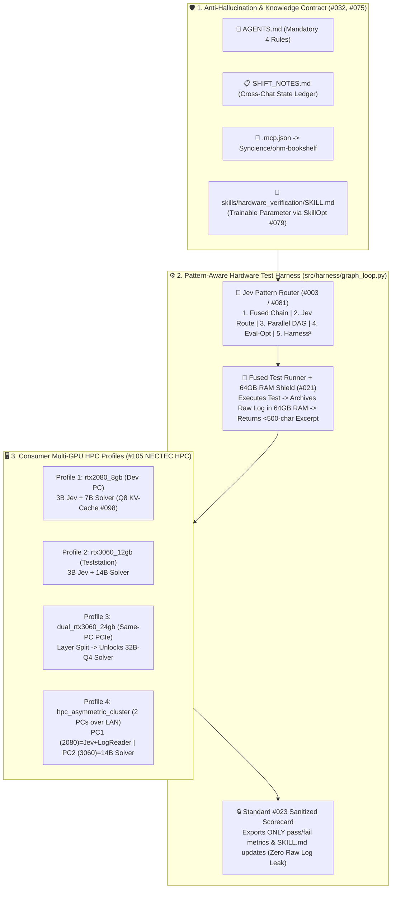

# 🛠️ `Syncience/hardware_test_agent`

**Confidential Local AI Agent & Multi-GPU HPC Harness for Hardware Testing (`RTX 2080 8GB` / `RTX 3060 12GB` / `Dual RTX 3060 24GB` + `64GB System RAM`).**

[](https://github.com/Syncience/hardware_test_agent)
[](https://github.com/Syncience/ohm-bookshelf)
[](./AGENTS.md)

---

## 🎯 Architecture Overview

Built on top of the knowledge base in **[`Syncience/ohm-bookshelf`](https://github.com/Syncience/ohm-bookshelf)**, this repository implements a **zero-data-leak, hardware-aware local AI testing agent** designed to be developed on an **NVIDIA RTX 2080 (8GB VRAM + 64GB RAM)** PC and cloned onto an air-gapped **NVIDIA RTX 3060 (12GB / 24GB Dual VRAM + 64GB RAM)** hardware teststation.



---

## 🛡️ Anti-Hallucination Handoff System (`AGENTS.md` + `SHIFT_NOTES.md`)

To prevent AI coding assistants from hallucinating non-existent hardware drivers, guessing pinouts, or losing context across chats:
1. **[`AGENTS.md`](./AGENTS.md)** enforces **Evidence-Grounded Execution**: no test can be marked passing without a deterministic `exit_code == 0` and a cryptographic `handle_id` receipt in `docker/ram_log_handles/`.
2. **[`SHIFT_NOTES.md`](./SHIFT_NOTES.md)** maintains an explicit ledger of **Verified Implemented Files** vs. **Planned Next Steps** so any new chat session knows the exact ground truth on Turn 1.
3. **[`.mcp.json`](./.mcp.json)** connects directly to [`Syncience/ohm-bookshelf`](https://github.com/Syncience/ohm-bookshelf) so the agent queries your 8 Specialist Teachers (`_teacher.md`) instead of guessing.

---

## 🚀 Quickstart & Usage

### 1. Clone Next to `ohm-bookshelf` & Install
```bash
git clone https://github.com/Syncience/hardware_test_agent.git
cd hardware_test_agent
pip install -e .
```

### 2. Run a Closed-Loop Hardware Test Cycle (Dev PC vs. Teststation Profiles)
```bash
# 1. Run on Dev PC (RTX 2080 8GB + 64GB RAM)
python -m src.harness.graph_loop --profile rtx2080_8gb \
  --task "Verify ERC/DRC and voltage rail tolerances" \
  --cmd "python -c \"print('ERC=0 DRC=0 3V3_RAIL=3.31V PASS')\""

# 2. Run Parallel Graph DAG (#002) across multiple test checks on Dual RTX 3060 (24GB VRAM)
python -m src.harness.graph_loop --profile dual_rtx3060_24gb \
  --task "Parallel multi-rail and signal integrity check" \
  --cmd "python -c \"print('Check 1: DDR Return Current OK')\"" \
  --cmd "python -c \"print('Check 2: Thermal Rise < 45C OK')\""
```

### 3. Launch the Air-Gapped Confidential Docker Container (`Standard #023`)
```bash
cd docker
GPU_PROFILE=rtx3060_12gb docker compose -f docker-compose.confidential.yml up --build
```

---

## 📄 License
MIT License — Built by [Syncience](https://github.com/Syncience).
